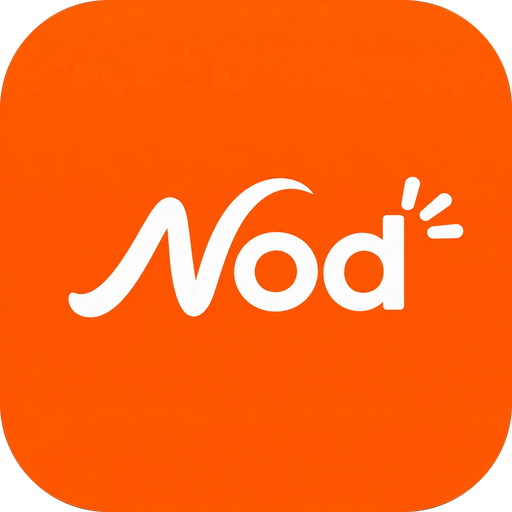
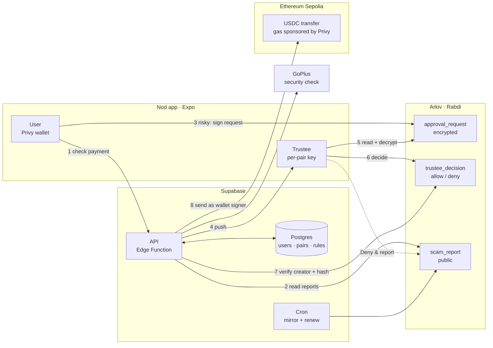

<p align="center">
  
</p>

<h1 align="center">Nod</h1>
<p align="center"><b>Risky payments, wait for a nod.</b></p>

<p align="center">
  <a href="https://getnod.pages.dev">Website</a> ·
  <a href="https://github.com/ombhanushaliii/nod/releases/download/v1.0.0/nod-v1.0.0.apk">Android APK</a> ·
  <a href="https://rabdi.explorer.arkiv.network">Arkiv explorer</a>
</p>

---

## What it is

Nod is a crypto wallet for people who are easy targets for scams, like parents, older relatives and first-time users.

Each user picks one **trustee**, someone they trust. The money stays theirs, and the trustee can never move it. But when a payment looks risky, it waits until the trustee nods.

- **Sign in with Google.** No seed phrase, no gas, no ETH to buy.
- **Every payment is checked first.** The checks are scam reports, a live security check (GoPlus), look-alike addresses and the amount limit.
- **Risky payments go to the trustee.** The user answers 3 quick questions, and the trustee gets a push with the context. They tap **Allow once** or **Deny & report**.
- **New people wait.** Someone you've never paid can get $10 right away. Anything more unlocks after 24 hours.
- **The first payment is capped at $10.**
- **Scams get blocked for everyone.** An address 5 trustees reported is blocked for all Nod users.
- **Key export needs the trustee too**, so a scammer can't talk someone into handing over their key.

The user and the trustee use the same app. Payments are test USDC on Ethereum Sepolia.

## How Nod uses Arkiv

Every safety decision lives on [Arkiv](https://arkiv.network) (Rabdi testnet), in three schemas:

| Schema | Written by | Lives | What it's for |
|---|---|---|---|
| `approval_request` | The user's own wallet | 24 h | A risky payment, encrypted so only the trustee can read it |
| `trustee_decision` | A private per-pair trustee key | 24 h (25 h for someone new) | Allow or deny, tied to the exact recipient and amount |
| `scam_report` | A trustee, or Nod's seed wallet for imported lists | 180 days, renewable by anyone | A public warning any wallet can check |

Why Arkiv and not a database:

- **Nobody can fake a yes.** The backend accepts an Allow only if its `$creator` is that pair's trustee key. It never signs approvals itself.
- **Things expire on their own.** Unanswered requests and old decisions disappear. There's no cleanup job, and nothing to replay.
- **Scam reports are public.** About 780 are live, from OFAC, Etherscan labels and Nod trustees. Any app can query them without our API, and they keep working even if Nod goes away:

  ```ts
  select().from(ScamReport).where(eq("address", "0x…"))
  ```

- **The trustee stays private.** Each user–trustee pair gets its own key, so nobody can link a trustee to the people they protect from the chain alone.

Names, emails, rules and the user–trustee link stay off-chain in Supabase.

The full write-up is in [`/arkiv`](arkiv/):

- [How we use Arkiv](arkiv/how-you-use-arkiv.md): each entity, what it's filtered on, and what users see
- [Why Arkiv](arkiv/why-arkiv.md): what users would lose on Postgres
- [Who it's for](arkiv/reach.md): who Nod is for, and how to try it
- [Friction](arkiv/friction.md): what we'd improve in Arkiv

## Architecture



1. The app sends the recipient and amount to the API.
2. The API runs the rules. It reads Arkiv scam reports, asks GoPlus, checks for look-alikes, then applies the limits. The answer is `safe`, `cooldown`, `needs_trustee` or `refused`.
3. If the trustee is needed, the user's wallet writes an encrypted `approval_request` to Arkiv.
4. The API checks the request on Arkiv and pushes the trustee.
5. The trustee's app reads the request from Arkiv and decrypts it on the phone.
6. The trustee's per-pair key writes a `trustee_decision`. **Deny & report** also writes a public `scam_report`.
7. The API verifies the decision: right creator, right recipient and amount, not used before.
8. The API sends the USDC as a signer on the user's wallet, with gas paid by Privy. A Privy policy limits that signer to USDC transfers.

Every hour, cron jobs copy verified reports into Postgres and renew them on Arkiv before they expire.

## Repo

| Path | What |
|---|---|
| [`frontend/`](frontend/) | The app (Expo, React Native, web). Both roles. |
| [`supabase/`](supabase/) | API (Deno + Hono), migrations, cron |
| [`packages/arkiv/`](packages/arkiv/) | Shared Arkiv schemas, encryption, reads and writes |
| [`services/backend/jobs/`](services/backend/jobs/) | Scam list importer (OFAC + eth-labels) |
| [`landing/`](landing/) | Website, invite page and key export page (Vite) |
| [`email/`](email/) | Invite and welcome emails |
| [`arkiv/`](arkiv/) | How and why Nod uses Arkiv |
| [`docs/`](docs/) | [Architecture decisions](docs/architecture-decisions.md), [deploy](docs/deploy.md), [Privy setup](docs/privy-wallet.md) |

## Setup

Every folder that needs secrets has a `.env.example`. Copy it to the file below, fill it in, and never commit the copy (git ignores them).

| Where | Copy to | For |
|---|---|---|
| `supabase/functions/.env.example` | `supabase/functions/.env` | The API |
| `frontend/.env.example` | `frontend/.env` | The app |
| `landing/.env.example` | `landing/.env.local` | The website, local runs only |
| `services/backend/jobs/.env.example` | `services/backend/jobs/.env` | The scam list importer |

**You need:**

- Node 20+, [Bun](https://bun.sh), and Android Studio (for the Android build)
- [Privy](https://dashboard.privy.io): an app with Google login, a key quorum as the backend signer, and a policy that only allows USDC transfers
- [Supabase](https://supabase.com): a project
- [Arkiv](https://hub.arkiv.network/access-keys): two access keys, one for the backend and one for the app
- A Rabdi wallet with tGLM, used as the seed wallet
- [Brevo](https://brevo.com): an API key and a verified sender, for invite emails

```bash
git clone https://github.com/ombhanushaliii/nod.git
cd nod
```

### 1. Backend (Supabase)

```bash
cp supabase/functions/.env.example supabase/functions/.env
npx supabase login
npx supabase link --project-ref <project-ref>
npx supabase db push
npx supabase secrets set --env-file supabase/functions/.env
npx supabase functions deploy api
```

Then, in the Supabase SQL editor, add the two secrets the hourly Arkiv jobs read. `<JOBS_SECRET>` is the value from your `.env`:

```sql
select vault.create_secret('https://<project-ref>.supabase.co', 'project_url');
select vault.create_secret('<JOBS_SECRET>', 'jobs_secret');
```

### 2. Website (invite and key export pages)

```bash
cd landing
cp .env.example .env.local
npm install
npm run dev
```

Production builds read `landing/.env.production` instead.

### 3. App

```bash
cd frontend
cp .env.example .env
npm install
npx expo run:android
```

Privy needs native modules, so use a development build, not Expo Go. `npm run web` runs the same app in a browser. For push, add `frontend/google-services.json` from Firebase.

### 4. Scam reports (optional)

This fills Arkiv with known scam wallets from OFAC and eth-labels. The first run is dry and writes nothing:

```bash
cd services/backend/jobs
cp .env.example .env
bun install
bun run import          # dry run: counts and worst-case cost
bun run import --yes    # write
```

More detail, the Privy setup and a two-phone test are in [docs/deploy.md](docs/deploy.md) and [docs/privy-wallet.md](docs/privy-wallet.md).

### Tests

```bash
cd frontend && npm run typecheck && npm run test:wallet
cd packages/arkiv && bun test
cd services/backend/jobs && bun test
cd supabase/functions/api && npx -y deno@2 test --allow-env --allow-net
```

## Limits

- Testnet only: Ethereum Sepolia and Arkiv Rabdi.
- The user owns their wallet, so a modified app with its own ETH could skip the checks. Nod makes that hard, not impossible.
- Within its policy, the backend signer can move a user's USDC. It's a trusted party for funds.
- Push works on Android. iOS still needs an APNs key.

---

Built at ETHGlobal Mumbai for the Arkiv track.
